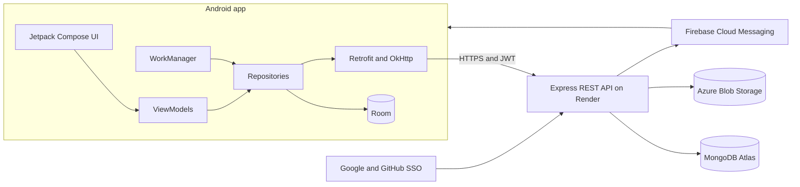

# FitQuest

[](https://github.com/ST10285120/PROG7314-PART2-ST10285120/actions/workflows/api.yml)
[](https://github.com/ST10285120/PROG7314-PART2-ST10285120/actions/workflows/android.yml)

FitQuest is a native Android strength-training app with a role-playing progression system. Users log sets offline in the gym, then earn XP, levels, streaks and badges from a custom cloud-hosted REST API.

> **Module:** PROG7314 Portfolio of Evidence · **Student:** Carson Norman (ST10285120)

## Demonstration video

**[Watch the FitQuest demonstration](PASTE_YOUR_UNLISTED_YOUTUBE_LINK_HERE)**

## Purpose

Research for this project found a gap between strength loggers such as Strong, which are reliable but offer little motivation, and social apps such as Strava, which motivate users but are not built for resistance training. FitQuest combines fast offline-first logging with gamification that the server controls, so progress cannot be changed on the phone.

## Features

| Area | What it does |
|---|---|
| Single Sign-On | Sign in with Google or GitHub. There is no password to store. |
| Biometric authentication | Fingerprint, face or device PIN after sign-in, on each launch and after five minutes in the background. |
| Offline mode | Workouts save to Room first and sync through WorkManager without duplicates once the phone reconnects. |
| Real-time notifications | Firebase Cloud Messaging for badges and level-ups, plus a local streak reminder at a chosen time. |
| Multi-language | English, Afrikaans and isiZulu, switchable in the app, including exercise and badge names. |
| Routines | Create, edit, delete and start custom routines, online or offline. |
| Settings | Units that convert all weights, theme, language, reminder time, rest timer, biometric lock and account details. |
| Personal records | Decided by the API against the user's full history. |
| Streaks and levels | Calculated by the API, with one grace day for a missed session. |
| Progress dashboard | Weekly volume chart, muscle group split, records and history that survives a reinstall. |
| Badges (user-defined feature 4) | Eight rule-based badges, with progress towards locked ones. |
| Suggested workouts (user-defined feature 5) | Rule-based suggestions built around the most rested muscle groups. |
| Blob storage | Profile pictures and progress photos in private Azure Blob Storage. |

## Architecture



## Design considerations

- **Offline first.** Room is written before any network call, so logging a set never waits for a connection.
- **Idempotent sync.** Each workout, exercise and set gets a UUID on the phone. `POST /api/workouts/sync` matches on those IDs, so a repeated request cannot duplicate data.
- **XP is awarded once.** Completing a workout atomically moves `completedAt` from null to a date, so only one request can win.
- **The server is the source of truth.** XP, levels, streaks, badges and personal records are decided by the API. While offline, the app shows a clearly marked estimate.
- **Private by default.** Photos are served through the API after a JWT and ownership check. The phone never holds the storage token.
- **Secrets stay out of Git.** Tokens are kept in `EncryptedSharedPreferences`, network logs exclude the `Authorization` header, and signing files are ignored by Git.

## DevOps

| Workflow | Runs when | What it does |
|---|---|---|
| `api.yml` | API code changes | Installs dependencies and runs Jest and Supertest against an in-memory MongoDB |
| `android.yml` | Android code changes | Runs JUnit tests and builds the debug APK |
| `deploy.yml` | API tests pass on `main` | Triggers the Render deploy hook |

## Repository layout

```text
FitQuest-android/   Kotlin Android app
fitquest-api/       Node.js and Express REST API
docs/               Setup, release notes, AI write-up, store material and demo script
.github/workflows/  CI and deployment
```

## Run it locally

Full setup, including Firebase, Azure and app signing, is in [docs/SETUP.md](docs/SETUP.md).

```bash
# API
cd fitquest-api
npm install
cp .env.example .env
npm run seed
npm run dev

# Android tests
cd ../FitQuest-android
./gradlew testDebugUnitTest
```

## API

The full endpoint list is in [fitquest-api/README.md](fitquest-api/README.md).

## Project documents

- [Release notes](docs/RELEASE_NOTES.md)
- [AI use write-up](docs/AI_USAGE.md)
- [Play Store readiness](docs/PLAY_STORE.md)
- [Privacy policy](docs/PRIVACY_POLICY.md)
- [Demo script](docs/DEMO_SCRIPT.md)
- [Rubric checklist](docs/RUBRIC_CHECKLIST.md)

## References

- Anthropic (2026) *Claude*. Available at: https://claude.ai
- Firebase (2026) *Send a message using FCM HTTP v1 API*. Available at: https://firebase.google.com/docs/cloud-messaging/send-message
- Google (2026) *Build an offline-first app*. Available at: https://developer.android.com/topic/architecture/data-layer/offline-first
- Google (2026) *Show a biometric authentication dialog*. Available at: https://developer.android.com/identity/sign-in/biometric-auth
- Microsoft (2026) *Put Blob*. Available at: https://learn.microsoft.com/en-us/rest/api/storageservices/put-blob
