# FitQuest evidence

Screenshots of the FitQuest app and its cloud services, captured for the PROG7314 Portfolio of Evidence. The live demonstration is in the video linked from the [README](../README.md).

## App on a physical phone

| Sign-in | Home | Choosing exercises |
|---|---|---|
| 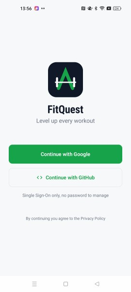 | 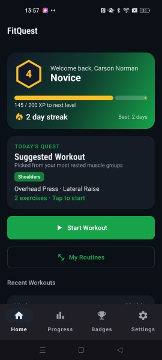 | 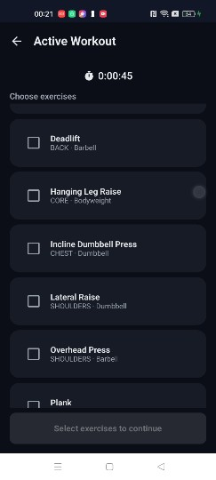 |

| Progress | Personal records | Workout history |
|---|---|---|
| 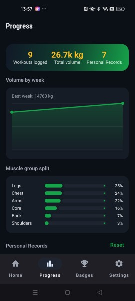 | 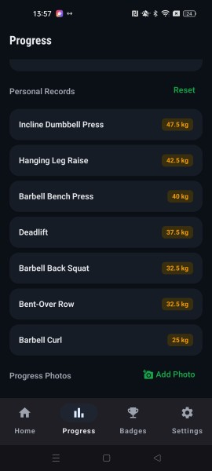 | 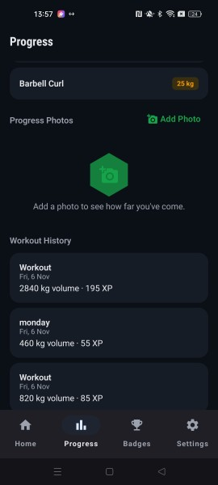 |

| Badges | Settings |
|---|---|
| 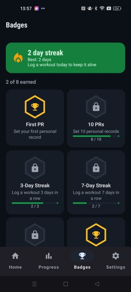 | 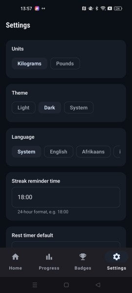 |

## Back-end database: MongoDB Atlas

The `fitquest` database and its collections.

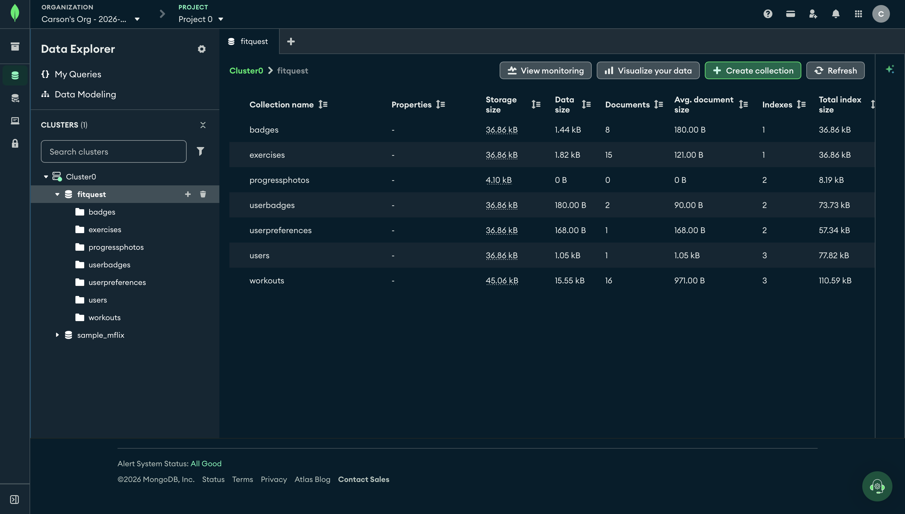

The exercise library used by the app.

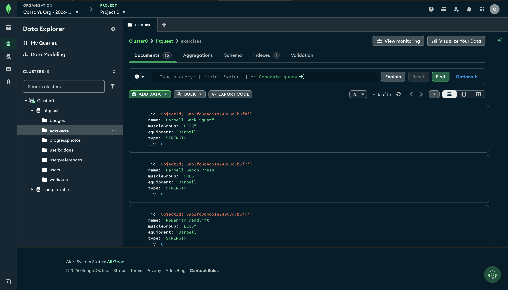

## Hosted API: Render

The FitQuest API deployed on Render.

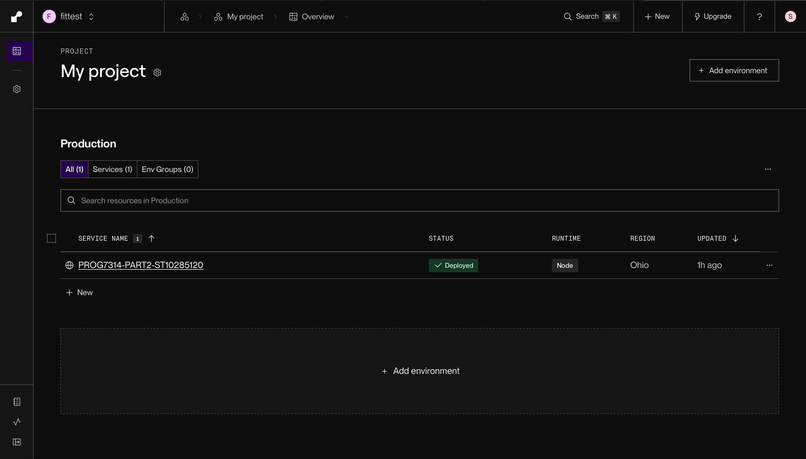

## Blob storage: Azure

The folder of profile pictures for a user in the private `fitquest-photos` container.

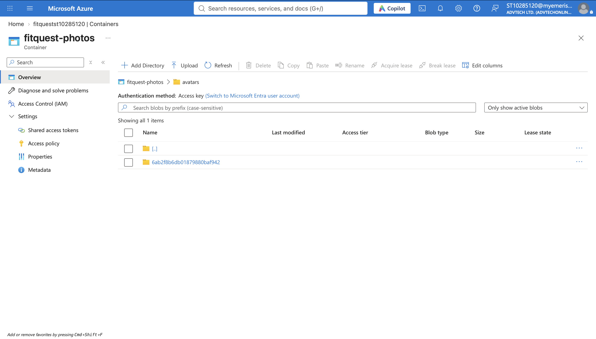

A profile picture stored as a blob.

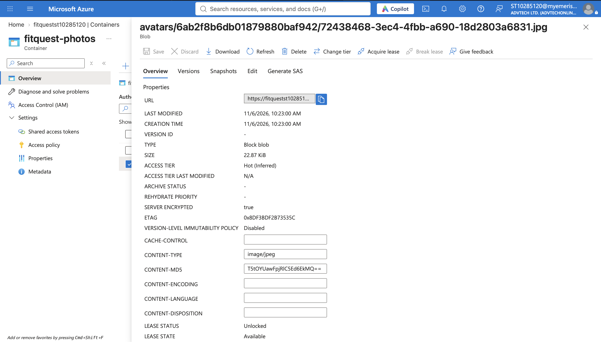

## Push notifications: Firebase

The FitQuest Firebase project.

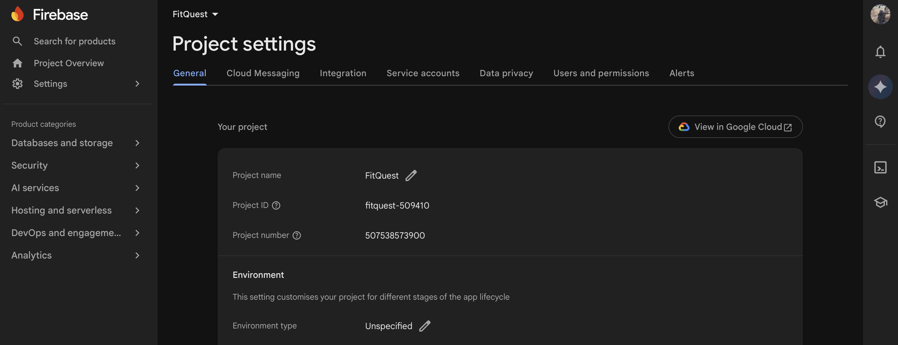
